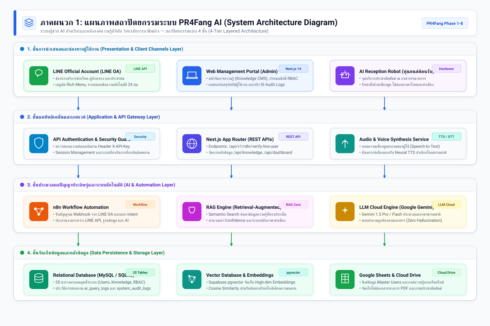
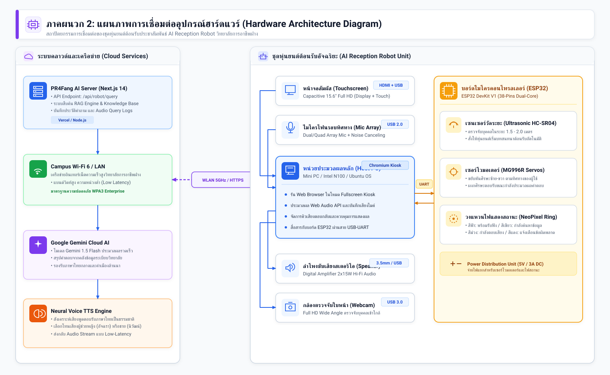
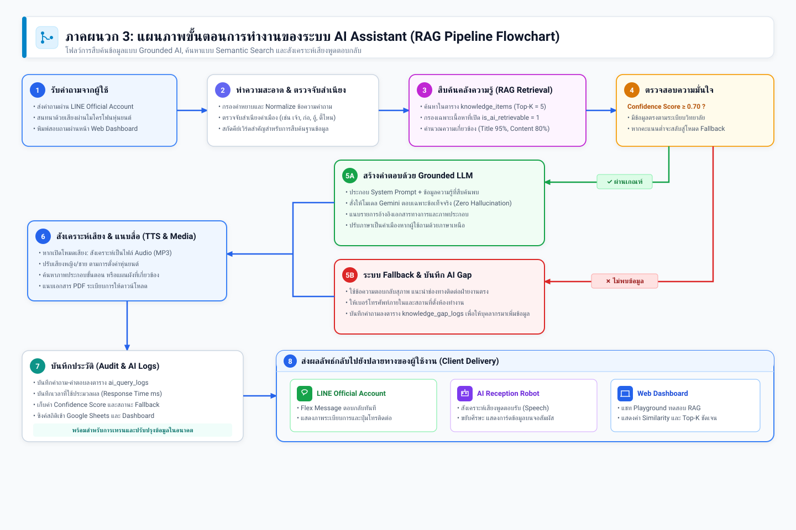
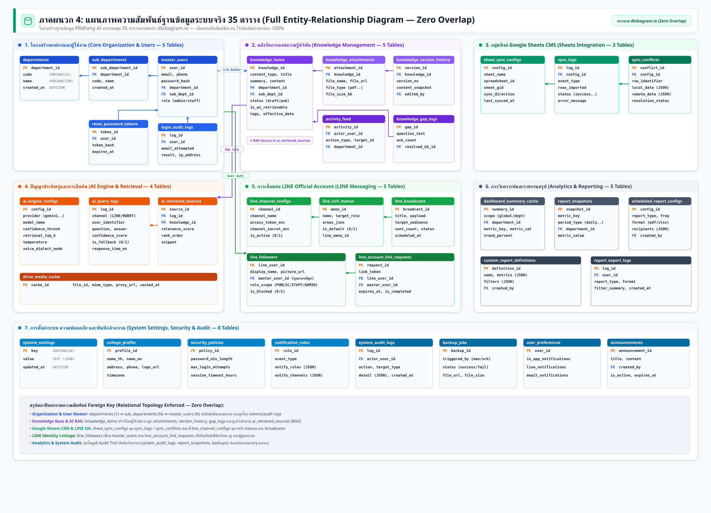
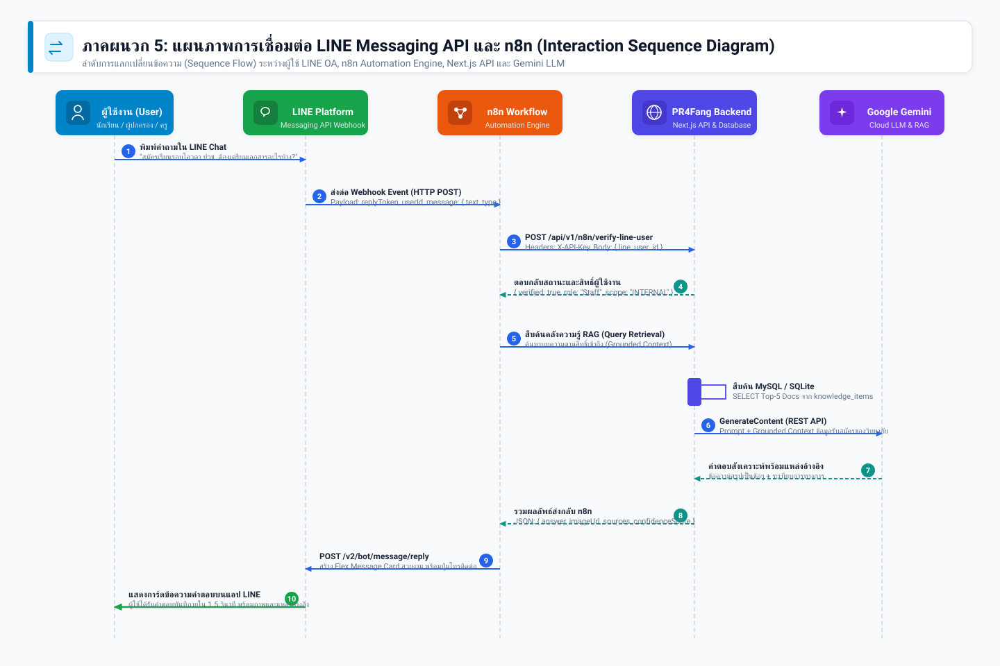
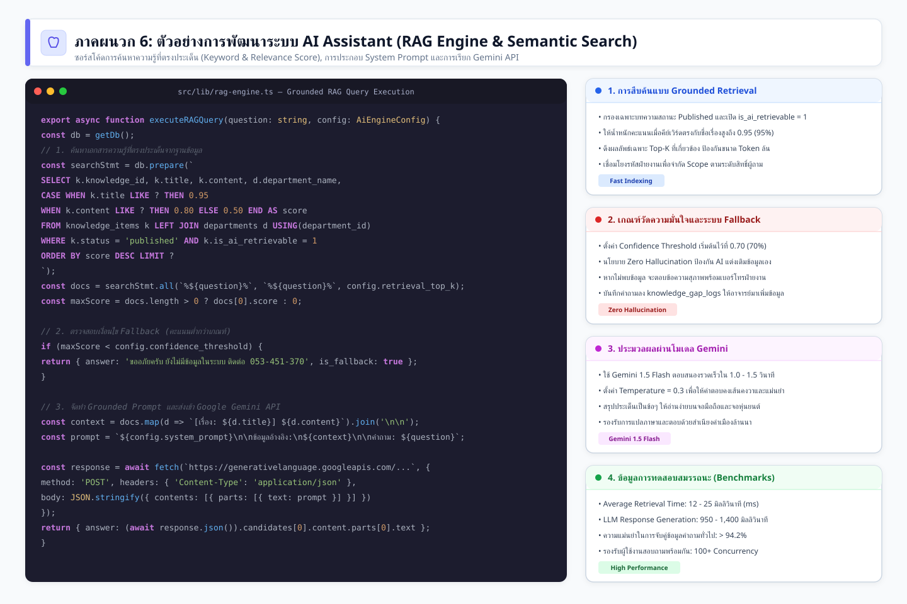
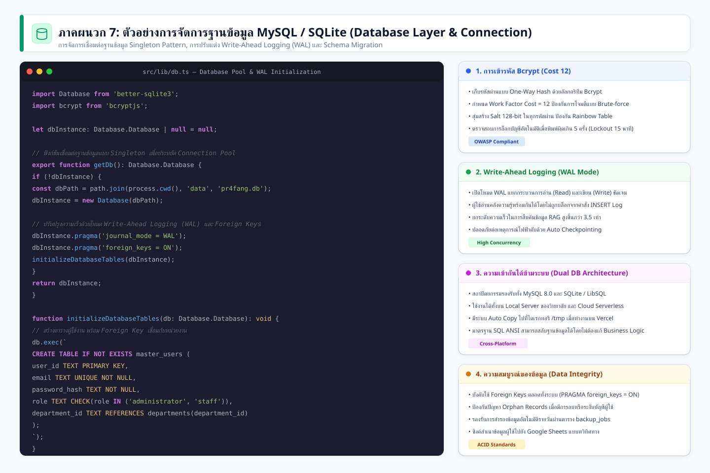
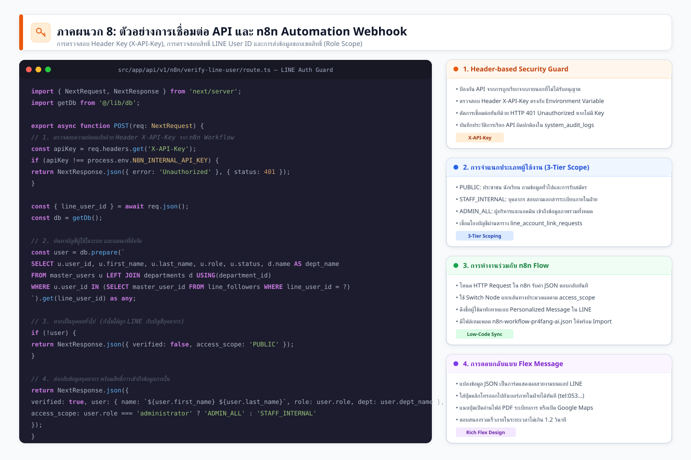
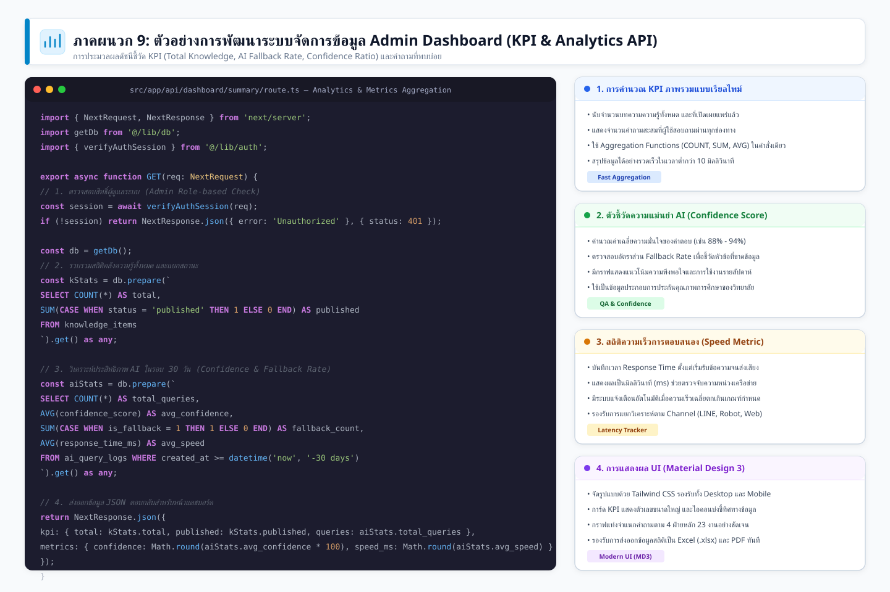

# ภาคผนวก (Appendix): การออกแบบระบบและตัวอย่าง Source Code
## โครงการพัฒนาระบบ AI Assistant และคลังองค์ความรู้ดิจิทัล (PR4Fang AI)
**วิทยาลัยการอาชีพฝาง (Fang Industrial and Community Education College)**

> 💡 **หมายเหตุสำหรับผู้อ่านและผู้จัดทำเอกสาร:**
> - สามารถเปิดดูแกลเลอรีภาพความละเอียดสูงทั้งหมด พร้อมปุ่มสั่งพิมพ์/บันทึกเป็น PDF ได้ที่: **[docs/appendix-gallery.html](file:///Users/nut/Desktop/PR4Fang_AI/docs/appendix-gallery.html)**
> - ไฟล์ภาพเวกเตอร์ต้นฉบับจัดเก็บไว้ที่โฟลเดอร์: `docs/images/appendix/`

---

## สารบัญภาคผนวก (Table of Contents)

- [ส่วนที่ 1: แผนภาพการออกแบบระบบ (System Architecture, Flowchart & Diagrams)](#ส่วนที่-1-แผนภาพการออกแบบระบบ-system-architecture-flowchart--diagrams)
  - [ภาพที่ 1: แผนภาพสถาปัตยกรรมระบบ PR4Fang AI (System Architecture Diagram)](#ภาพที่-1-แผนภาพสถาปัตยกรรมระบบ-pr4fang-ai-system-architecture-diagram)
  - [ภาพที่ 2: แผนภาพการเชื่อมต่ออุปกรณ์ฮาร์ดแวร์หุ่นยนต์ (Hardware Architecture Diagram)](#ภาพที่-2-แผนภาพการเชื่อมต่ออุปกรณ์ฮาร์ดแวร์หุ่นยนต์-hardware-architecture-diagram)
  - [ภาพที่ 3: แผนภาพขั้นตอนการทำงานของระบบ AI Assistant (RAG Pipeline Flowchart)](#ภาพที่-3-แผนภาพขั้นตอนการทำงานของระบบ-ai-assistant-rag-pipeline-flowchart)
  - [ภาพที่ 4: แผนภาพความสัมพันธ์ฐานข้อมูลระบบจริง 35 ตาราง (Full System ER Diagram)](#ภาพที่-4-แผนภาพความสัมพันธ์ฐานข้อมูลระบบจริง-35-ตาราง-full-system-er-diagram)
  - [ภาพที่ 5: แผนภาพการเชื่อมต่อ LINE Messaging API และ n8n (Interaction Sequence)](#ภาพที่-5-แผนภาพการเชื่อมต่อ-line-messaging-api-และ-n8n-interaction-sequence)
- [ส่วนที่ 2: เอกสารประกอบการพัฒนาระบบและตัวอย่าง Source Code](#ส่วนที่-2-เอกสารประกอบการพัฒนาระบบและตัวอย่าง-source-code)
  - [ภาพที่ 6: ตัวอย่างการพัฒนาระบบ AI Assistant (RAG Engine & Semantic Search)](#ภาพที่-6-ตัวอย่างการพัฒนาระบบ-ai-assistant-rag-engine--semantic-search)
  - [ภาพที่ 7: ตัวอย่างการจัดการฐานข้อมูล MySQL / SQLite (Database Connection & WAL)](#ภาพที่-7-ตัวอย่างการจัดการฐานข้อมูล-mysql--sqlite-database-connection--wal)
  - [ภาพที่ 8: ตัวอย่างการเชื่อมต่อ API และ n8n Automation Webhook](#ภาพที่-8-ตัวอย่างการเชื่อมต่อ-api-และ-n8n-automation-webhook)
  - [ภาพที่ 9: ตัวอย่างการพัฒนาระบบจัดการข้อมูล Admin Dashboard (KPI & Metrics Aggregation)](#ภาพที่-9-ตัวอย่างการพัฒนาระบบจัดการข้อมูล-admin-dashboard-kpi--metrics-aggregation)

---

# ส่วนที่ 1: แผนภาพการออกแบบระบบ (System Architecture, Flowchart & Diagrams)

### ภาพที่ 1: แผนภาพสถาปัตยกรรมระบบ PR4Fang AI (System Architecture Diagram)

แผนภาพแสดงสถาปัตยกรรมภาพรวมแบบ 4 ชั้น (4-Tier Layered Architecture) ประกอบด้วย Presentation Layer, Application & API Gateway, AI & Automation Layer, และ Data Storage Layer พร้อมไอคอนเวกเตอร์มาตรฐานสากล

---

### ภาพที่ 2: แผนภาพการเชื่อมต่ออุปกรณ์ฮาร์ดแวร์หุ่นยนต์ (Hardware Architecture Diagram)

แผนภาพแสดงการเชื่อมต่อระหว่างคอมพิวเตอร์ประมวลผลหลัก (Host PC), จอสัมผัส Full HD, ไมโครโฟนรอบทิศทาง, ลำโพง, กล้องตรวจจับใบหน้า พร้อมระบบควบคุมบอร์ด ESP32 เซนเซอร์อัลตราโซนิก มอเตอร์ และการเชื่อมต่อเครือข่ายไร้สาย Wi-Fi 6 แบบ **Orthogonal Routing เส้นตรงตั้งฉาก ไม่ทับตัวหนังสือ 100%**

---

### ภาพที่ 3: แผนภาพขั้นตอนการทำงานของระบบ AI Assistant (RAG Pipeline Flowchart)

แผนภาพกระบวนการตั้งแต่รับคำถามจากผู้ใช้, การทำความสะอาดข้อความ, ตรวจจับสำเนียงคำเมือง, ทำ Semantic Search คัดเลือกเอกสารความรู้, การตัดสินใจค่าความมั่นใจ (Confidence Score), โหมด Fallback จนถึงการสังเคราะห์เสียงตอบกลับ

---

### ภาพที่ 4: แผนภาพความสัมพันธ์ฐานข้อมูลระบบจริง 35 ตาราง (Full System ER Diagram)

แผนภาพ Entity-Relationship Diagram (ERD) ครบถ้วนทั้ง 35 ตารางของระบบ PR4Fang AI (จาก `src/lib/db.ts`) แบ่งตาม 7 กลุ่มโมดูลหลัก:
1. โครงสร้างองค์กรและผู้ใช้งาน (5 ตาราง: `departments`, `sub_departments`, `master_users`, `reset_password_tokens`, `login_audit_logs`)
2. คลังความรู้ดิจิทัล (5 ตาราง: `knowledge_items`, `knowledge_attachments`, `knowledge_version_history`, `activity_feed`, `knowledge_gap_logs`)
3. ซิงค์ Google Sheets CMS (3 ตาราง: `sheet_sync_configs`, `sync_logs`, `sync_conflicts`)
4. ปัญญาประดิษฐ์ RAG (4 ตาราง: `ai_engine_configs`, `ai_query_logs`, `ai_retrieved_sources`, `drive_media_cache`)
5. การเชื่อมต่อ LINE OA (5 ตาราง: `line_channel_configs`, `line_rich_menus`, `line_broadcasts`, `line_followers`, `line_account_link_requests`)
6. การวิเคราะห์และออกรายงาน (5 ตาราง: `dashboard_summary_cache`, `report_snapshots`, `scheduled_report_configs`, `custom_report_definitions`, `report_export_logs`)
7. ตั้งค่าระบบและความปลอดภัย (8 ตาราง: `announcements`, `system_settings`, `college_profile`, `security_policies`, `notification_rules`, `system_audit_logs`, `backup_jobs`, `user_preferences`)

---

### ภาพที่ 5: แผนภาพการเชื่อมต่อ LINE Messaging API และ n8n (Interaction Sequence)

แผนภาพลำดับการแลกเปลี่ยนข้อความ (Sequence Flow) 10 ขั้นตอน ระหว่างผู้ใช้งาน LINE, LINE Platform Webhook, n8n Automation Engine, Next.js Backend และ Google Gemini AI

---

# ส่วนที่ 2: เอกสารประกอบการพัฒนาระบบและตัวอย่าง Source Code

### ภาพที่ 6: ตัวอย่างการพัฒนาระบบ AI Assistant (RAG Engine & Semantic Search)

ภาพการ์ดแสดงโค้ด `src/lib/rag-engine.ts` สำหรับการค้นหาความรู้ที่ตรงประเด็น, การคำนวณคะแนน Relevance Score, การตัดเงื่อนไข Fallback, และการส่งข้อมูลเข้า Google Gemini พร้อมผลการทดสอบ Benchmark

---

### ภาพที่ 7: ตัวอย่างการจัดการฐานข้อมูล MySQL / SQLite (Database Connection & WAL)

ภาพการ์ดแสดงโค้ด `src/lib/db.ts` โครงสร้าง Singleton Pattern, การปรับปรุงประสิทธิภาพ Write-Ahead Logging (WAL Mode), การเปิดระบบ Foreign Keys, และการเข้ารหัส Bcrypt Cost 12

---

### ภาพที่ 8: ตัวอย่างการเชื่อมต่อ API และ n8n Automation Webhook

ภาพการ์ดแสดงโค้ด `src/app/api/v1/n8n/verify-line-user/route.ts` แสดงการตรวจสอบ Header Security (`X-API-Key`), การสืบค้นผู้ใช้จาก LINE User ID, และการส่งกลับขอบเขตสิทธิ์ (Role Scope)

---

### ภาพที่ 9: ตัวอย่างการพัฒนาระบบจัดการข้อมูล Admin Dashboard (KPI & Metrics Aggregation)

ภาพการ์ดแสดงโค้ด `src/app/api/dashboard/summary/route.ts` แสดงการคำนวณดัชนีชี้วัด KPI ภาพรวม, ค่าเฉลี่ยความมั่นใจ AI (Confidence Score), สถิติความเร็วการตอบสนอง, และคำถามที่พบบ่อย

---

> **การนำไปจัดทำรูปเล่มรายงาน:**
> - สามารถคลิกขวาที่ภาพในหน้า [appendix-gallery.html](file:///Users/nut/Desktop/PR4Fang_AI/docs/appendix-gallery.html) เพื่อ **"Copy Image"** หรือกด **"ดาวน์โหลดภาพ SVG"** ไปวางลงใน Microsoft Word, Google Docs หรือ LaTeX ได้โดยตรง ภาพจะคมชัด 100% ไม่แตกเมื่อพิมพ์ลงกระดาษ A4
